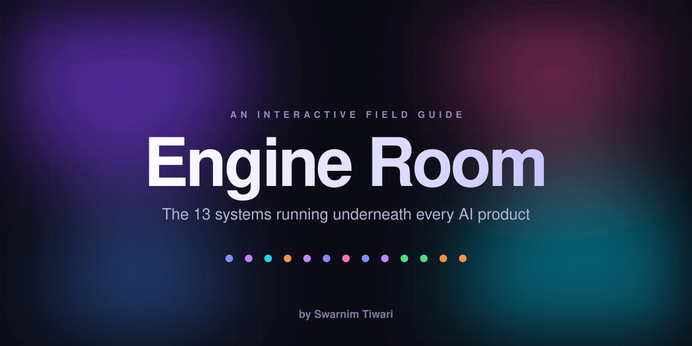

<div align="center">



<h3>The 13 systems running underneath every AI product, explained like a person wrote it.</h3>

<br />

[](https://frontier-advanced-ai.vercel.app)
[](https://github.com/SWARNIM-TIWARI/engine-room/stargazers)
[](LICENSE)
[](https://react.dev)
[](https://vite.dev)
[](CONTRIBUTING.md)

<br />

[**Open the site**](https://frontier-advanced-ai.vercel.app) &nbsp;·&nbsp; [The 13 systems](#the-13-systems) &nbsp;·&nbsp; [Run it locally](#run-it-locally) &nbsp;·&nbsp; [Roadmap](#roadmap) &nbsp;·&nbsp; [Suggest a topic](../../issues/new?template=topic_suggestion.md)

</div>

<br />

## Why this exists

Every time someone says "federated learning" or "mechanistic interpretability" in a meeting, half the room nods and the other half quietly opens a new tab. I was in the second half more often than I'd like to admit.

There is endless content about what AI products can do and almost nothing about what they are built on. So this is the thing I wanted to read: the systems underneath, explained in plain English first, with the real techniques and working code one tap away.

## How to use it

1. Open the [live site](https://frontier-advanced-ai.vercel.app) and tap any card.
2. Read the **Overview**. It starts with the idea, then what researchers are still stuck on.
3. Swipe left or right (or tap the tabs) to jump to **Techniques** and **Code**.
4. Scroll down in Overview for a live Wikipedia summary and a short list of books, papers and tools.

## The 13 systems

Tap a row to open it.

<details>
<summary><b>01 &nbsp;Knowledge Graphs</b> &nbsp;·&nbsp; how a search engine answers a question no single page answers</summary>

<br />

Facts stored as connected, named relationships instead of rows in a table. You can follow chains of connections in one query, which is what makes "what country is the Eiffel Tower in" answerable without a page that says it.

**Techniques:** RDF and SPARQL, KG embeddings (TransE, RotatE), relational GNNs, KGQA
**Start with:** PyKEEN, Wikidata Query Service

</details>

<details>
<summary><b>02 &nbsp;Multi-Agent Systems</b> &nbsp;·&nbsp; what changes when one model becomes a team</summary>

<br />

Coordination, credit assignment, and agents that learn to talk to each other. The hard part is not building one smart agent. It is getting several to produce one coherent result.

**Techniques:** CTDE, emergent communication, Nash equilibria, LLM agent orchestration
**Start with:** PettingZoo, AutoGen

</details>

<details>
<summary><b>03 &nbsp;Distributed AI</b> &nbsp;·&nbsp; splitting training across many GPUs without the sync cost eating you alive</summary>

<br />

Big models do not fit on one machine, so the work gets split. Most of the engineering is about making the communication between machines cheaper.

**Techniques:** data parallelism, tensor and pipeline parallelism, ZeRO, gradient checkpointing
**Start with:** DeepSpeed, PyTorch FSDP

</details>

<details>
<summary><b>04 &nbsp;GPU Architecture and CUDA</b> &nbsp;·&nbsp; why memory, not math, decides how fast your model runs</summary>

<br />

Most of the time a GPU is waiting for data, not calculating. Fast kernels are mostly about keeping the cores fed.

**Techniques:** memory coalescing, shared memory tiling, tensor cores, occupancy tuning
**Start with:** Triton, CUTLASS

</details>

<details>
<summary><b>05 &nbsp;Reinforcement Learning</b> &nbsp;·&nbsp; learning what to do from reward alone</summary>

<br />

Observe, act, get a reward, update. The same loop trains game agents, robots, and the tuning step that makes language models helpful.

**Techniques:** PPO, Soft Actor-Critic, Monte Carlo Tree Search, Hindsight Experience Replay
**Start with:** Gymnasium, Stable-Baselines3

</details>

<details>
<summary><b>06 &nbsp;Federated Learning</b> &nbsp;·&nbsp; training on data that never leaves the device</summary>

<br />

Each device or institution trains locally and only sends model updates. The raw data stays where it was.

**Techniques:** FedAvg, DP-SGD, secure aggregation, personalized FL
**Start with:** Flower, PySyft

</details>

<details>
<summary><b>07 &nbsp;AI Security</b> &nbsp;·&nbsp; models can be fooled, poisoned, copied and made to leak</summary>

<br />

How each class of attack works, and which defenses actually hold up against someone adaptive.

**Techniques:** PGD attacks, certified robustness, prompt injection, membership inference
**Start with:** Adversarial Robustness Toolbox, CleverHans

</details>

<details>
<summary><b>08 &nbsp;Causal Inference</b> &nbsp;·&nbsp; seeing X and doing X are not the same thing</summary>

<br />

The toolkit for separating correlation from cause, which is what you need before making any decision based on a model.

**Techniques:** DAGs and d-separation, do-calculus, instrumental variables, Difference-in-Differences
**Start with:** DoWhy

</details>

<details>
<summary><b>09 &nbsp;Mechanistic Interpretability</b> &nbsp;·&nbsp; treating a trained network like a program you can read</summary>

<br />

Work out what specific circuits, heads and neurons actually compute instead of describing the model from outside.

**Techniques:** activation patching, sparse autoencoders, logit lens, automated circuit discovery
**Start with:** TransformerLens

</details>

<details>
<summary><b>10 &nbsp;AI for Operations Research</b> &nbsp;·&nbsp; routing and scheduling with too many options to brute force</summary>

<br />

Learned heuristics that build or improve solutions to combinatorial problems far faster than an exact solver can.

**Techniques:** attention based construction, learned LNS, predict then optimize, RL for scheduling
**Start with:** Google OR-Tools, Gurobi

</details>

<details>
<summary><b>11 &nbsp;Digital Twins</b> &nbsp;·&nbsp; a simulation that stays synced to the real thing</summary>

<br />

A live computational mirror of a physical system, fed by sensor data, used to predict and test changes without touching the original.

**Techniques:** physics informed neural networks, Kalman and particle filters, neural operators, mesh GNNs
**Start with:** DeepXDE, NVIDIA Omniverse

</details>

<details>
<summary><b>12 &nbsp;Compiler Design for ML</b> &nbsp;·&nbsp; the same model, noticeably faster, without changing the model</summary>

<br />

The compiler decides how your computation graph maps onto hardware. Fusion, layout and tiling choices add up.

**Techniques:** operator fusion, auto tuning, Tensor IR, MLIR dialects
**Start with:** Apache TVM, OpenXLA, Triton

</details>

<details>
<summary><b>13 &nbsp;Inference Optimization</b> &nbsp;·&nbsp; training happens once, serving happens every second</summary>

<br />

How to make serving big models cheaper and faster, mostly by attacking memory bandwidth and the KV cache.

**Techniques:** quantization, speculative decoding, paged KV cache, FlashAttention
**Start with:** vLLM, llama.cpp

</details>

<br />

Every card on the site also has working code, a plain English "what is still being figured out" section, and a live Wikipedia summary.

## Run it locally

```bash
git clone https://github.com/SWARNIM-TIWARI/engine-room.git
cd engine-room
npm install
npm run dev
```

Then open `http://localhost:5173`. You need Node 18 or newer.

```bash
npm run build     # production build into dist/
npm run preview   # serve the build locally
```

## Deploy your own

[](https://vercel.com/new/clone?repository-url=https://github.com/SWARNIM-TIWARI/engine-room)
&nbsp;
[](https://app.netlify.com/start/deploy?repository=https://github.com/SWARNIM-TIWARI/engine-room)

Both detect Vite on their own. No environment variables, no backend, nothing to configure.

## Project layout

```
engine-room/
├─ .github/
│  ├─ ISSUE_TEMPLATE/      bug reports, topic ideas, content corrections
│  ├─ workflows/ci.yml     builds on every push and pull request
│  └─ PULL_REQUEST_TEMPLATE.md
├─ docs/
│  ├─ banner.svg           animated README banner
│  └─ social-preview.png   upload this in repo Settings
├─ public/
│  ├─ favicon.svg
│  └─ og.png               link preview image
├─ src/
│  ├─ App.jsx              all 13 topics plus the UI
│  ├─ index.css            aurora background and clay card styles
│  └─ main.jsx
├─ index.html
├─ package.json
└─ vite.config.js
```

## Notes from building it

A few decisions that came from things breaking:

- **Content is hardcoded on purpose.** The 13 topics live in `src/App.jsx`, so the site works with no backend and nothing to rate limit. Wikipedia is the only live call.
- **Wikipedia lookups use the search API.** The first version guessed page slugs directly and failed on titles with parentheses. Now it searches, then fetches the summary of the best hit and tries the next result if one comes back empty.
- **The modal card is solid.** A glass effect looked good over the aurora background in some browsers and was hard to read in others, so the card has an opaque background now.

## Roadmap

- [x] 13 topics with Overview, Techniques and Code tabs
- [x] Live Wikipedia summaries
- [x] Swipe between tabs on mobile
- [ ] **Collision Lab.** Pick any two topics and see where they meet: causal inference with reinforcement learning, interpretability with knowledge graphs, digital twins with federated learning
- [ ] **Debate Arena.** One agent per discipline arguing about a hard question
- [ ] **GPU kernel visualizer.** Watch warps, memory coalescing and tiling happen
- [ ] A source link next to every number and claim
- [ ] Search and category filters
- [ ] Keyboard navigation
- [ ] Light theme

Have an idea that is not on the list? [Open an issue](../../issues/new?template=topic_suggestion.md).

## Contributing

The most useful contribution is a correction. If something in a card is wrong, out of date or oversimplified, open a [content correction](../../issues/new?template=content_correction.md) with the card name and a source. Adding a topic or fixing code is welcome too. Start with [CONTRIBUTING.md](CONTRIBUTING.md).

## How it was made

Concept, direction and curation by Swarnim Tiwari. The code was built with heavy help from AI (Claude by Anthropic).

## Star history

<a href="https://star-history.com/#SWARNIM-TIWARI/engine-room&Date">
  
</a>

## Author

**Swarnim Tiwari**

[](https://www.linkedin.com/in/swarnimtiwari1)
[](https://github.com/SWARNIM-TIWARI)

If this saved you a few open tabs, a star helps other people find it.

## License

[MIT](LICENSE). Use it, fork it, learn from it.
